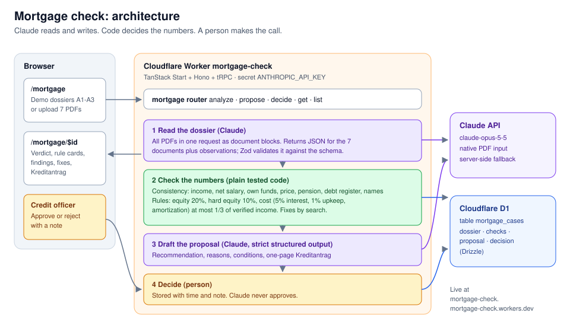

# Mortgage check

Upload a home buyer's documents and get a credit decision you can check. Claude reads all seven PDFs at once and flags where they contradict each other. Plain, tested code applies the Swiss lending rules. Claude then drafts the credit proposal (Kreditantrag), and a credit officer makes the final call.

**Live demo:** https://mortgage-check.mortgage-check.workers.dev/mortgage



## Built at the Claude Opus 5.5 Build Day, Zurich

This project was built in one evening on 6 October 2026 at the Claude Opus 5.5 Build Day Workshop in Zurich. Claude Community Zurich hosted it at SIX ConventionPoint.

## How it works

1. **Read the dossier (Claude).** All PDFs go to `claude-opus-5-5` in one request, using native PDF input. Claude returns one JSON object covering the application form, salary certificate, tax return, debt enforcement register, pension statement, bank statement and sales documentation, plus anything else worth noticing. Zod validates the reply against the schema.
2. **Check the numbers (code, no model).** `packages/services/src/mortgage` compares the documents with each other (income, net salary, own funds, price, pension withdrawal, debt register, names). It then applies the rule sheet, and when a rule fails it works out what would make the case pass. The numbers come from the documents, not from what the applicant claims: income from the salary certificate, own funds capped by the bank statement.
3. **Draft the proposal (Claude).** Claude gets the extracted data, the rule results and the findings, and writes a recommendation and a one-page Kreditantrag. Strict structured output keeps the shape fixed. It may not recompute or overrule the rule engine.
4. **Decide (a person).** The credit officer approves or rejects with a note. Every case, with its findings, proposal and decision, is stored in Cloudflare D1.

The rules are in [docs/rule-sheet.md](docs/rule-sheet.md).

## Results on the demo dossiers

The three dossiers from the event are in [`apps/web/public/demo`](apps/web/public/demo). The demo buttons on `/mortgage` load them.

| Applicant | Price | Result | Why | What would fix it |
| --- | --- | --- | --- | --- |
| A1 Thomas Meier | CHF 900'000 | Pass | Equity 22.2%, cost 30.7% of income | Nothing |
| A2 Nicole Baumgartner | CHF 1'100'000 | Fail | Equity from her own funds, not the pension fund, is CHF 70'000 (6.4%); 10% is required | CHF 40'000 more own funds |
| A3 Daniel Schmid | CHF 1'250'000 | Fail | Costs need CHF 210'333 income; the salary certificate shows CHF 175'000. The application claims CHF 190'000 including a bonus the certificate does not show, which would still fail | Price at most CHF 1'106'000, or a co-borrower with CHF 35'400 income, or CHF 101'000 more equity |

A3 also has a paid 2024 entry in the debt enforcement register, which the app flags as a point to clarify.

## Run it

You need [Bun](https://bun.sh) 1.3 or newer and an [Anthropic API key](https://console.anthropic.com).

```bash
bun install
cp apps/web/.dev.vars.example apps/web/.dev.vars   # add ANTHROPIC_API_KEY
bun run dev
```

Open http://localhost:3000/mortgage. The first `bun run dev` asks before setting up the local database; if the prompt hangs, run `bunx wrangler d1 migrations apply DB --local` in `apps/web` once.

Tests: `bun run test`. The rule engine tests reproduce the worked example and all three applicants.

### Deploy

The app runs on Cloudflare Workers with a D1 database. From `apps/web`:

```bash
bunx wrangler login
bunx wrangler d1 create mortgage-check     # put the id in wrangler.jsonc
bunx wrangler d1 migrations apply DB --remote
bunx wrangler secret put ANTHROPIC_API_KEY
bun run deploy
```

The app has no login. Anyone with the URL can run checks on your API key.

## Repository layout

- `apps/web`: the TanStack Start app on Cloudflare Workers. Pages are in `src/routes/mortgage`, and the API is tRPC over Hono. See its [README](apps/web/README.md).
- `packages/services`: the mortgage service. `rules.ts` is the rule engine, `dossier.ts` holds the schema and the consistency checks, and `claude.ts` has the two Claude calls. See its [README](packages/services/README.md).
- `packages/db`: the Drizzle schema and migrations for D1, including the `mortgage_cases` table. See its [README](packages/db/README.md).
- `docs`: the rule sheet, the architecture diagram, and [notes on the boilerplate](docs/boilerplate.md) this started from.

## Credits

- The exercise, rule sheet and demo dossiers come from the Claude Opus 5.5 Build Day in Zurich, organized by Claude Community Zurich. All applicants, banks and properties are fictional.
- Built on [cf-tanstack-boilerplate](https://github.com/codewithpassion/cf-tanstack-boilerplate).
- Built with [Claude Code](https://claude.com/claude-code).

This is a hackathon demo, not lending or financial advice.

## License

[MIT](LICENSE)
